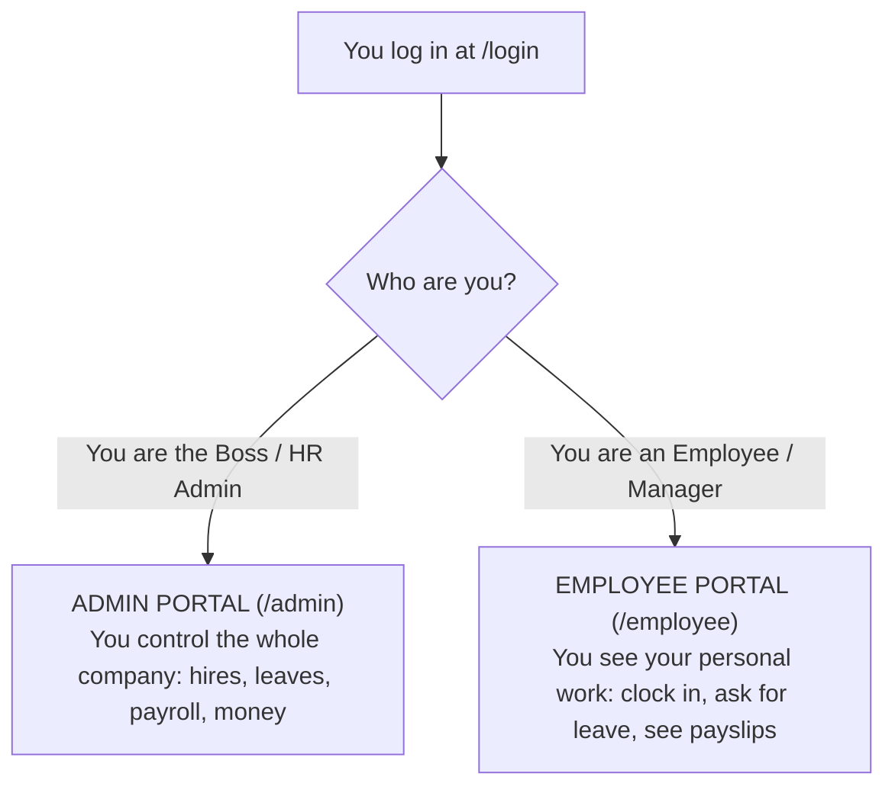
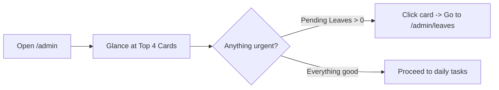
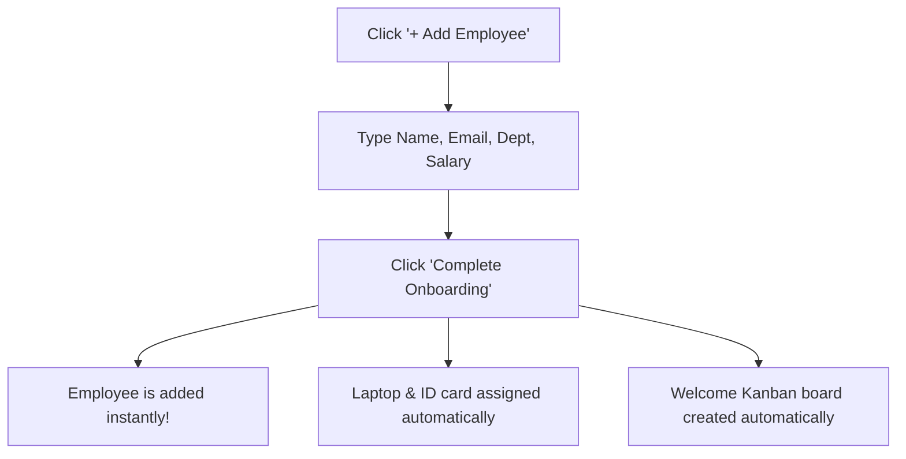
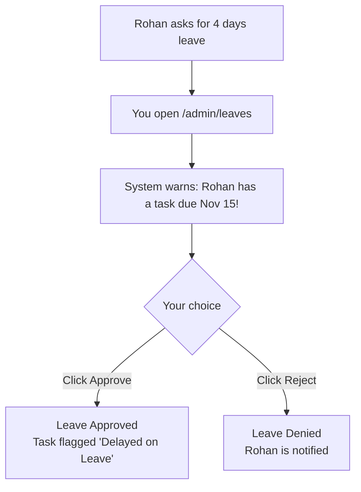
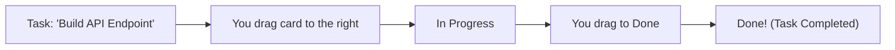
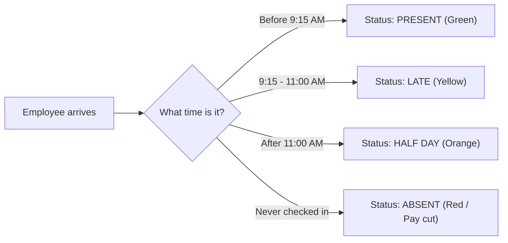
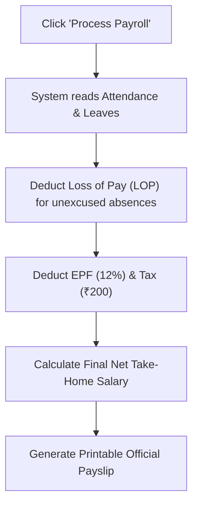

# Workplace EMS — Simple Operator & Demo Guide
> **Written for anyone operating this website with zero prior training.**

---

## Welcome! Start Here

If you were just handed this website and told: **"You are in charge of running it"**, this guide is for you.

You do **not** need to know any programming or technical terms. Everything is explained in everyday English:
- **What each page is**
- **Why you need it**
- **What you see on the screen**
- **Exact step-by-step clicks to do things**
- **A simple diagram**
- **What to say if you are giving a live demo or presentation**

---

## Quick Navigation: The 2 Portals

The website has **two main sections** depending on who logs in:

---

## How to Log In Right Now (In 10 Seconds)

1. Open your browser and go to: **`http://localhost:3001/login`**
2. You will see a box that says **"Demo Accounts"** at the top.
3. Click it and pick who you want to be:
   - **Arjun Mehta (CEO / Super Admin)** $\rightarrow$ Picks the big boss. You can see and change everything.
   - **Neha Kapoor (HR Admin)** $\rightarrow$ Picks the HR manager. You handle leaves, hiring, and payroll.
   - **Rohan Sharma (Team Manager)** $\rightarrow$ Picks a manager. You manage your direct team's tasks and workload.
   - **Ananya Verma (Employee)** $\rightarrow$ Picks a regular employee. You clock in, apply for leaves, and submit expenses.
4. Click the blue **Sign In** button. That's it! You are inside!

---

# SECTION 1: THE ADMIN PORTAL (For Site Operators & HR)

---

### Page 1: Admin Home Dashboard (`/admin`)

#### 1. What is this page?
This is your **cockpit / command center**. As soon as you log in as an administrator, this page gives you a snapshot of everything happening in the company today.

#### 2. Why do you need it?
Instead of clicking 10 different pages to see how many people came to work or how many requests are waiting for you, this page puts all the vital signs on one screen.

#### 3. What do you see on your screen?
- **4 Big Stat Cards**:
  - **Total Headcount**: How many people work in the company (currently 26).
  - **Onboarding**: How many new hires joined this week.
  - **On Leave Today**: Who is away on vacation or sick today.
  - **Pending Requests**: How many leaves or expense claims are waiting for your approval.
- **Department Chart**: A visual pie/bar chart showing which departments have the most people.
- **Recent Activity Feed**: A list showing the latest things that happened (e.g., *"Rohan Sharma submitted a leave request"*).

#### 4. How to operate it (Step-by-step)
- **To see who is on leave**: Look at the "On Leave Today" card. Click it to jump straight to the Leaves page.
- **To review pending requests**: Look at the "Pending Requests" card. Click it to go directly approve them.

#### 5. Demo Lecture Script (What to say to an audience):
> *"This is our Admin Dashboard. Think of it like the dashboard in your car. In three seconds, the executive can see company headcount, today's attendance rate, and how many pending decisions are waiting on their desk."*

---

### Page 2: Company Directory (`/admin/directory`)

#### 1. What is this page?
This is the **master employee phonebook**. It lists every single person who works at your company.

#### 2. Why do you need it?
When you need to find someone's phone number, email, job title, manager, or salary, this is where you go. You also use this page to add a new employee to the company.

#### 3. What do you see on your screen?
- **Department Dropdown Filter**: A dropdown with 12 departments (Software Engineering, Product & Design, People Operations, etc.). Every department has 2 to 3 real employees.
- **Search Box**: Type any name, skill (like "React" or "Figma"), or job title, and the list filters instantly.
- **Employee Table / Cards**: Shows photo, name, email, phone, department, manager, and employment status (`ACTIVE`, `ONBOARDING`, `ON_LEAVE`).
- **"+ Add Employee" Button**: A big blue button in the top right corner.

#### 4. How to operate it (Step-by-step)

##### A. How to filter by department:
1. Click the dropdown that says **"All departments"**.
2. Click **"Software Engineering"**.
3. You will see exactly the 3 engineers: Rohan Sharma, Rahul Verma, and Kavya Nair.

##### B. How to add a new employee:
1. Click the blue **"+ Add Employee"** button.
2. A window pops up. Fill in:
   - First Name & Last Name (e.g., *Amit Patel*)
   - Email (e.g., *amit@workplace.com*)
   - Department (e.g., *Software Engineering*)
   - Designation (e.g., *Frontend Developer*)
   - Basic Monthly Salary (e.g., *70000*)
3. Click **"Complete Onboarding"**.
4. **Magic happens**: The system automatically adds Amit, calculates his housing allowance, issues him a company laptop, and creates a 9-step welcome task list for him!

#### 5. Demo Lecture Script:
> *"Here in the Company Directory, we maintain 26 authentic team members across 12 departments. When an HR admin adds a new hire, our system doesn't just save their name — it automatically provisions their equipment and sets up their entire first-week task board."*

---

### Page 3: Employee Detail View (`/admin/directory/[id]`)

#### 1. What is this page?
This is an individual employee's **digital personnel file**.

#### 2. Why do you need it?
When you want to see everything about **one specific person** — their full salary breakdown, who their manager is, what company equipment they have, and their uploaded documents.

#### 3. What do you see on your screen?
- **Header**: Employee name, job title, department badge, and status.
- **Salary Breakdown Card**: Basic Pay, HRA (Housing), Allowances, and Total CTC.
- **Assigned Assets Card**: Shows equipment given to them (e.g. *MacBook Pro, Security Access Pass*).
- **Reporting Line**: Shows who they report to and who reports to them.
- **Document Vault**: Copies of their ID, tax forms, or contracts.

#### 4. How to operate it:
1. Go to `/admin/directory`.
2. Click on any employee's name (for example, click **Rohan Sharma**).
3. The full profile opens up. You can inspect their details or click **"Edit Profile"** to change their phone number or title.

---

### Page 4: Leave Management & Approvals (`/admin/leaves`)

#### 1. What is this page?
This is where **time-off requests** come to be approved or rejected by management.

#### 2. Why do you need it?
Employees cannot just stay home without permission. When they apply for annual leave, sick leave, or casual leave, their request appears here so the boss can say **Yes (Approve)** or **No (Decline)**.

#### 3. What do you see on your screen?
- **Pending Requests Queue**: Cards showing who wants leave, what dates, how many days, and their reason (e.g., *"Family trip to Himachal Pradesh"* or *"Dental surgery"*).
- **Task Warning Alert (The Connected Wedge)**: A yellow or red alert box that says: *"Warning: This person has 1 task due while they are away!"*
- **Peer Cover Suggestion**: The system automatically suggests another person in the same department who is free to cover their work!
- **Green "Approve" Button** and **Red "Reject" Button**.

#### 4. How to operate it (Step-by-step):
1. Go to `/admin/leaves`.
2. Look at the top card in the **Pending Requests** section.
3. Read their reason and check the warning box.
4. **To say Yes**: Click the green **Approve** button.
   - *What happens*: The leave is approved, days are deducted from their balance, and any task due during that time is marked in red so the team knows it might be delayed.
5. **To say No**: Click the red **Reject** button.
   - *What happens*: The leave is denied, and their days are given back.

#### 5. Demo Lecture Script:
> *"Here is our Leave Management. Notice our 5 pending requests with real business reasons. But look at this warning box: our system actively alerts the manager if the employee has a project due during their absence, and automatically suggests a teammate to cover for them."*

---

### Page 5: Projects & Kanban Boards (`/admin/projects`)

#### 1. What is this page?
This is the **project task board** (often called a Kanban board). It looks like a digital whiteboard with sticky notes.

#### 2. Why do you need it?
To track who is working on what, what is finished, and what is running late.

#### 3. What do you see on your screen?
- **4 Columns**:
  - **Backlog**: Tasks waiting to be started.
  - **In Progress**: Tasks people are actively working on right now.
  - **Under Review**: Tasks finished and waiting for the boss to check.
  - **Done**: Completed tasks!
- **Task Cards**: Each card shows task title, priority (Low, Medium, High, Urgent), who is assigned, and due date.
- **Red Alert Badge**: If an employee went on leave, their card gets a red banner: **"Delayed — On Leave"**.

#### 4. How to operate it (Step-by-step):

##### A. How to move a task:
1. Click and hold any card with your mouse.
2. Drag it to another column (e.g. from *In Progress* to *Done*).
3. Let go of the mouse. The task is now officially marked complete!

##### B. How to create a new task:
1. Click the **"+ New Task"** button at the top of any column.
2. Type the task name (e.g., *"Design new login button"*).
3. Pick an assignee (e.g., *Ananya Verma*).
4. Pick a due date.
5. Click **"Create Task"**.

#### 5. Demo Lecture Script:
> *"Our Projects module gives teams a drag-and-drop Kanban workflow. But unlike standard Trello or Jira, when an HR event occurs — like an employee taking sick leave — the task automatically stamps itself with a 'Delayed on Leave' warning flag."*

---

### Page 6: Attendance & Clock-In (`/admin/attendance`)

#### 1. What is this page?
This is the **daily attendance register**. It tracks who came to work, what time they arrived, and who is late.

#### 2. Why do you need it?
To ensure employees are working their contracted hours and to calculate penalties for people who don't show up.

#### 3. What do you see on your screen?
- **Today's Attendance Counter**: Shows how many people are present, late, on leave, or absent.
- **Live Clock Widget**: Digital clock showing current time.
- **Employee Attendance Table**: Shows check-in time, check-out time, total hours, and status:
  - **Green (PRESENT)**: Arrived on time (before 9:15 AM).
  - **Yellow (LATE)**: Arrived after 9:15 AM.
  - **Orange (HALF DAY)**: Arrived after 11:00 AM.
  - **Red (ABSENT)**: Did not show up.
- **Timesheets Approval Queue**: List of project hours logged by staff waiting for signoff.

#### 4. How to operate it:
- As an Admin, you view the table to see who is working.
- Scroll down to **"Timesheets"** and click **Approve** on hours submitted by employees so they get credit for their project work.

---

### Page 7: Payroll & Salary Slips (`/admin/payroll`)

#### 1. What is this page?
This is where **salaries are calculated and payslips are generated**.

#### 2. Why do you need it?
At the end of every month, companies must pay their workers. Calculating pay by hand in Excel takes days. This page does the entire calculation in **one click**.

#### 3. What do you see on your screen?
- **Month Selector**: Dropdown to choose which month to pay (e.g. *November 2026*).
- **"Process Payroll" Button**: A big button that runs the calculation.
- **Payroll Table**: Shows every employee's:
  - Base Salary
  - Allowances
  - **Loss of Pay (LOP)**: Money deducted if they took unexcused days off!
  - **Taxes & EPF**: Legal deductions.
  - **Net Pay**: The exact money deposited into their bank account.
- **"View Payslip" Button**: Opens a formal, printable PDF payslip for that worker.

#### 4. How to operate it (Step-by-step):
1. Go to `/admin/payroll`.
2. Click the purple **"Process Payroll"** button.
3. The system checks attendance, deducts pay for unexcused absences, applies taxes, and computes final amounts.
4. Click **"View Payslip"** next to any employee (e.g. *Rohan Sharma*).
5. A formal company payslip pops up with the company logo, earnings, and deductions.
6. Click **"Print"** to save it as a PDF or print it on paper!

#### 5. Demo Lecture Script:
> *"Processing payroll in Workplace EMS takes literally one second. Our engine pulls biometric attendance, automatically deducts Loss of Pay for unexcused absences, applies legal provident funds, and generates bank-ready payslips ready to print."*

---

### Page 8: Expenses & Money Claims (`/admin/expenses`)

#### 1. What is this page?
This is where employees ask the company to **reimburse them** for money they spent on behalf of the company (meals with clients, monitors, travel cabs, certifications).

#### 2. Why do you need it?
Employees shouldn't pay for company costs out of their own pocket. But the company must verify the receipt before paying them back.

#### 3. What do you see on your screen?
- **Pending Claims Table**:
  - Who spent the money (e.g., *Varun Nair*).
  - Category (e.g., *Training, Meals, Equipment*).
  - Amount in Rupees (e.g., *₹18,500*).
  - Description (e.g., *"Kubernetes certification voucher"*).
  - Attached Receipt file link (e.g., *`receipt.pdf`*).
- **Green "Approve"** and **Red "Decline"** buttons.

#### 4. How to operate it:
1. Go to `/admin/expenses`.
2. Click on the receipt link to view the invoice.
3. If it is a legitimate expense, click **Approve**.
   - *What happens*: The claim is approved and automatically added to their next paycheck!
4. If it's invalid, click **Decline**.

---

### Page 9: Performance Appraisals (`/admin/performance`)

#### 1. What is this page?
The **yearly / quarterly report card** system for employees.

#### 2. Why do you need it?
To decide who gets a promotion, who gets a raise, and who needs help improving.

#### 3. What do you see on your screen?
- **Active Review Cycle**: Shows the current appraisal period (e.g. *Q4 2026 Annual Cycle*).
- **Two Scores**: Shows the employee's **Self-Rating** (what they think of themselves) alongside the **Manager's Rating** (what their boss thinks of them).
- **Rating Scale**: 1 (Poor) to 5 (Outstanding).

#### 4. How to operate it:
1. Go to `/admin/performance`.
2. Click **"New Appraisal Cycle"** to start review season.
3. Review submitted scores and manager feedback in the table below.

---

### Page 10: Access & Permissions (`/admin/access`)

#### 1. What is this page?
The **security room**. It decides who is allowed to enter each page.

#### 2. Why do you need it?
Regular employees should not be allowed to see other people's salaries or change company settings. This page lets you lock or unlock features for each role.

#### 3. What do you see on your screen?
- **The Permission Matrix Table**: A grid with checkboxes.
  - Rows: Features (Leaves, Payroll, Directory, Projects, Settings).
  - Columns: Roles (Super Admin, HR Admin, Manager, Employee).
- **User Role Table**: Lists every employee with a button to change their role.

#### 4. How to operate it:
1. Want Managers to be able to see the Payroll page? Check the box under *Manager* next to *Payroll*.
2. Click **"Save Permissions"**.
3. Want to promote *Neha Kapoor* to Super Admin? Click **"Change Role"** next to her name, select *Super Admin*, and click Save.

---

### Page 11: Reports & Analytics (`/admin/reports`)

#### 1. What is this page?
The **data export and charts** room.

#### 2. Why do you need it?
When the CEO asks: *"How much money did we spend on engineering salaries this year?"* or *"How many sick leaves were taken in October?"*, this is where you get the answer.

#### 3. What do you see on your screen?
- **Tabs**: Headcount Reports, Leave Utilization, Payroll Spend, Project Velocity.
- **Charts**: Graphs showing salary trends and department sizes.
- **"Export CSV" Button**: Downloads the table straight to an Excel file.

#### 4. How to operate it:
1. Click the tab you want (e.g. *Payroll*).
2. Click the blue **"Export CSV"** button.
3. Open the downloaded file in Microsoft Excel or Google Sheets!

---

### Page 12: Company Settings (`/admin/settings`)

#### 1. What is this page?
The **configuration room** for the business.

#### 2. Why do you need it?
To set office work hours, define official paid holidays (like Republic Day or Diwali), and customize company information.

#### 3. How to operate it:
1. **To add a public holiday**: Scroll down to *Holiday Calendar*, type *"Diwali"*, select the date, and click **"Add Holiday"**.
   - *Result*: The system will automatically not deduct leave days from employees on that date!
2. **To reset demo data**: Click the red **"Reset Demo Data"** button if you made test changes and want the system back to clean default state.

---

### Page 13: Org Chart (`/admin/org-chart`)

#### 1. What is this page?
The **visual family tree** of the company.

#### 2. Why do you need it?
To see who reports to whom in a clean interactive tree diagram.

#### 3. How to operate it:
1. Navigate to `/admin/org-chart`.
2. Click on the **$(+)$** symbol under Arjun Mehta (CEO) to reveal his direct executives.
3. Click on **Vikram Iyer (VP Engineering)** to see the entire engineering department tree unfold!

---

# SECTION 2: THE EMPLOYEE PORTAL (For Regular Staff)

When a regular worker (like *Ananya Verma*) logs in, they see a simple personal hub designed just for them:

---

### Page 14: Employee Home Hub (`/employee`)
- **What it is**: Your personal desk.
- **What you do**: Click the big green **"Clock In"** button when you start your day, check your tasks for today, and see your leave balance.

---

### Page 15: My Tasks (`/employee/tasks`)
- **What it is**: Your personal to-do list.
- **What you do**: Drag tasks you are working on into *Done* as you complete them.

---

### Page 16: Request Leave (`/employee/leaves`)
- **What it is**: How you ask your boss for vacation or sick days.
- **What you do**:
  1. Click **"Request Leave"**.
  2. Choose start date and end date.
  3. Pick leave type (*Annual*, *Sick*, or *Casual*).
  4. Type your reason (e.g., *"Sister's wedding"*).
  5. Click **"Submit Request"**. Your manager will immediately get an alert on their phone/screen!

---

### Page 17: My Payslips (`/employee/payslips`)
- **What it is**: Where you view and download your salary slips.
- **What you do**: Click **"View Payslip"** on any past month to view your earnings, tax deductions, and download a PDF for your visa or home loan application.

---

### Page 18: File an Expense (`/employee/expenses`)
- **What it is**: Getting paid back for money you spent for the company.
- **What you do**: Click **"New Claim"**, enter the amount you spent, attach a photo of your receipt, and click **Submit**.

---

### Page 19: My Profile (`/employee/profile`)
- **What it is**: Your personal account settings.
- **What you do**: Update your phone number, update your home address, upload your ID documents, or change your password.

---

### Page 20: Manager Team Hub (`/employee/team`)
*(Only visible if you are a Manager like Rohan Sharma)*
- **What it is**: The manager's team-oversight screen.
- **What you do**:
  1. See who on your team is at work today.
  2. See if anyone on your team has too many tasks.
  3. **Reassign Delayed Tasks**: If one of your team members is on sick leave, click **"Reassign Cover"** to give their task to another available team member with a single click!

---

## 3 Golden Rules for Operating This Website

1. **If you see a red badge on a task**: That means the person assigned to it is on leave! Go to `/employee/team` or `/admin/projects` and reassign it to someone else.
2. **If you have pending requests**: Always check the warning alerts on `/admin/leaves` before clicking Approve so you know if important deadlines will be missed.
3. **At the end of the month**: Go to `/admin/payroll`, click **Process Payroll**, and your team's salary calculations are completely done!

---

*Manual maintained by Team Magnum. Workplace Employee Management System (EMS).*
