# Workplace EMS - Complete Website Operator Manual & Demo Lecture Guide

Welcome to the **Workplace Employee Management System (EMS)** Operator Manual and Lecture Guide. 

This document explains the **purpose**, **functionality**, **step-by-step operating procedures**, and **demonstration script** for every page in the application. It is written in simple, plain language so that any website administrator, operator, HR officer, or presenter can run the platform effortlessly, explain its features to an audience, and understand how data flows across the system.

---

## Table of Contents

1. [Platform Overview & Core Concept](#1-platform-overview--core-concept)
2. [User Roles & Demo Login Credentials](#2-user-roles--demo-login-credentials)
3. [The "Connected Wedge" Architecture](#3-the-connected-wedge-architecture)
4. [Master 10-Minute Demo Lecture Script](#4-master-10-minute-demo-lecture-script)
5. [Page-by-Page Operator Manual](#5-page-by-page-operator-manual)
   - [Page 1: Authentication & Role Gateway](#page-1-authentication--role-gateway)
   - [Page 2: Company Directory, Onboarding & Profiles](#page-2-company-directory-onboarding--profiles)
   - [Page 3: Leave Management & Absence Approvals](#page-3-leave-management--absence-approvals)
   - [Page 4: Projects, Tasks & Interactive Kanban](#page-4-projects-tasks--interactive-kanban)
   - [Page 5: Attendance, Clock-In & Timesheets](#page-5-attendance-clock-in--timesheets)
   - [Page 6: Payroll Processing, Salaries & LOP Deductions](#page-6-payroll-processing-salaries--lop-deductions)
   - [Page 7: Executive Admin Overview & KPI Dashboard](#page-7-executive-admin-overview--kpi-dashboard)
   - [Page 8: Expenses, Reimbursements & Receipt Auditing](#page-8-expenses-reimbursements--receipt-auditing)
   - [Page 9: Performance Management & 360° Appraisals](#page-9-performance-management--360-appraisals)
   - [Page 10: Access Control & Role-Based Permissions (RBAC)](#page-10-access-control--role-based-permissions-rbac)
   - [Page 11: Executive Reports, BI & CSV Export](#page-11-executive-reports-bi--csv-export)
   - [Page 12: Organization Settings, Shifts & Holidays](#page-12-organization-settings-shifts--holidays)
   - [Page 13: Notifications Center & Live Organization Feed](#page-13-notifications-center--live-organization-feed)
   - [Page 14: Visual Organization Hierarchy & Org Chart](#page-14-visual-organization-hierarchy--org-chart)
   - [Page 15: My Profile & Employee Self-Service (ESS)](#page-15-my-profile--employee-self-service-ess)
   - [Page 16: My Team & Manager Collaboration Hub](#page-16-my-team--manager-collaboration-hub)
6. [Operator Recipes: Quick "How-To" Cheatsheet](#6-operator-recipes-quick-how-to-cheatsheet)
7. [Troubleshooting & FAQ](#7-troubleshooting--faq)

---

## 1. Platform Overview & Core Concept

**Workplace EMS** is an all-in-one corporate Operating System designed to replace scattered HR tools, spreadsheets, and task trackers. 

Instead of keeping employee data in one tool, attendance in another, and project tasks in a third, Workplace EMS brings everything into a single, cohesive interface.

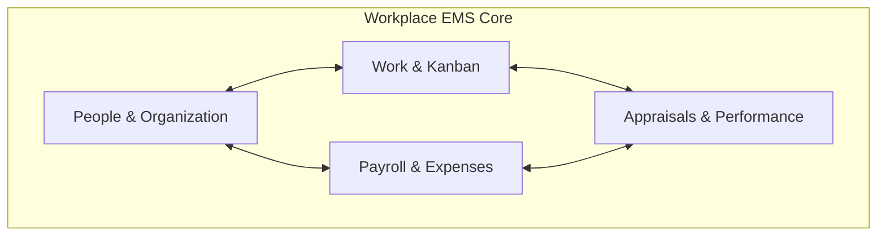

---

## 2. User Roles & Demo Login Credentials

The platform enforces **Role-Based Access Control (RBAC)** across four core tiers. You can log into any of these roles with the default demo password: `demo1234`.

| Role | Demo Email | Persona | Key Responsibilities |
|---|---|---|---|
| **Super Admin** | `arjun@workplace.com` | **Arjun Mehta** (CEO) | Full access to every page, RBAC settings, organization config, and global analytics. |
| **HR Admin** | `neha@workplace.com` | **Neha Kapoor** (VP People Ops) | Employee onboarding, leaves, attendance, payroll runs, and department operations. |
| **Manager** | `rohan@workplace.com` | **Rohan Sharma** (Lead Frontend Architect) | Team workload oversight, task delegation, peer cover approval, timesheet signoff, reviews. |
| **Employee** | `ananya@workplace.com` | **Ananya Verma** (Product Designer) | Clock-in/out, personal tasks, leave requests, expense filing, self-review, payslip download. |

---

## 3. The "Connected Wedge" Architecture

The biggest selling point of Workplace EMS is its **Connected Wedge** reactive engine. When something happens in one department, the rest of the company automatically responds:

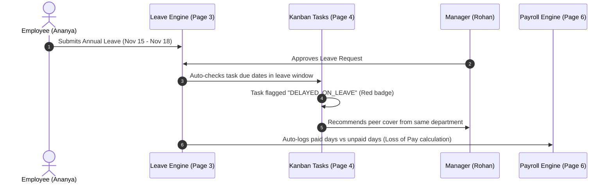

---

## 4. Master 10-Minute Demo Lecture Script

If you are giving a live lecture or presenting this website to an audience (examiners, professors, investors, or executives), follow this battle-tested script:

### Slide / Step 1: The Hook (1 minute)
> *"Good morning everyone. Today we are presenting Workplace EMS. Most companies suffer from 'tool fragmentation' — HR uses one software for leaves, finance uses spreadsheets for payroll, and engineering uses another tool for tasks. When an engineer goes on leave, their project gets silently delayed because the tools don't talk to each other. Workplace EMS solves this through a unified, 4-layer connected enterprise architecture."*

### Slide / Step 2: The Login & Role Dispatcher (1 minute)
> *"Let's log in at `/login`. Notice the quick-login dropdown: we can switch effortlessly between Super Admin, HR Admin, Manager, and Employee. Let's start as Arjun Mehta, our CEO."*

### Slide / Step 3: Executive Overview Dashboard (1 minute)
> *"Upon login, we arrive at `/admin`. Here we see executive KPI metrics: total headcount, onboarding count, attendance rate today, and active payroll spend. Below, we see live interactive charts for department distribution, monthly attendance trends, and real-time pending approvals."*

### Slide / Step 4: Directory & Atomic Onboarding (2 minutes)
> *"Let's navigate to `/admin/directory`. Notice the department dropdown: every department is populated with 2 to 3 real corporate professionals. When we click 'Add New Hire', the Connected Wedge triggers: it doesn't just create an employee record, it auto-allocates equipment (Laptop, Access Card) and automatically creates a dedicated Onboarding Kanban Board with 9 standard starter tasks."*

### Slide / Step 5: The Reactive Leave & Delay Engine (2 minutes)
> *"Next is `/admin/leaves`. Here we see 5 pending leave requests from real team members. Notice what happens when an employee takes leave: the system automatically inspects their Kanban tasks. If a critical task is due during their absence, the task is automatically flagged as 'DELAYED_ON_LEAVE' and recommends a peer in the same department to cover for them."*

### Slide / Step 6: Payroll & Loss of Pay (LOP) (1.5 minutes)
> *"Moving to `/admin/payroll`. Running payroll usually takes days of manual spreadsheet work. In Workplace EMS, one click on 'Process Payroll' pulls biometric attendance, deducts Loss of Pay (LOP) for unexcused absences, applies EPF and Professional Tax, and generates printable payslips for every employee."*

### Slide / Step 7: Team Collaboration & Conclusion (1.5 minutes)
> *"Finally, we log in as a Manager at `/employee/team`. Managers can see their direct reports' live workload, pending leaves with task-collision risk badges, and reassign tasks with a single click. Everything is backed by a secure PostgreSQL database on Supabase with instant in-memory fallback. Thank you!"*

---

## 5. Page-by-Page Operator Manual

---

### Page 1: Authentication & Role Gateway
- **Routes**: `/`, `/login`, `/signup`, `/dashboard`
- **Component Files**: `frontend/src/app/page.tsx`, `frontend/src/app/(auth)/login/page.tsx`, `frontend/src/app/dashboard/page.tsx`

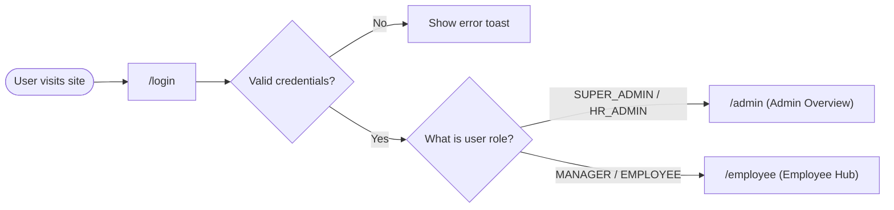

#### Purpose
To securely authenticate employees and route them to their designated portal based on their permission level.

#### Functionality
- **Demo Quick-Fill Dropdown**: Allows testing the system without typing credentials manually.
- **Session Tokens**: Generates signed, tamper-proof session tokens.
- **Account Status Guard**: Automatically blocks suspended or terminated accounts.
- **Role Dispatcher**: Redirects Admins to `/admin` and Employees/Managers to `/employee`.

#### How to Operate
1. Go to `http://localhost:3001/login`.
2. To test quickly, click the **Demo Accounts** dropdown at the top of the card and select a user (e.g. *Arjun Mehta - Super Admin*).
3. The email and password will auto-fill. Click **Sign In**.
4. To test a real email, type your corporate email (e.g. `rohan@workplace.com`) and password (`demo1234`) and click **Sign In**.

---

### Page 2: Company Directory, Onboarding & Profiles
- **Routes**: `/admin/directory`, `/admin/directory/[id]`, `/admin/onboarding`
- **Component Files**: `frontend/src/app/admin/directory/page.tsx`, `frontend/src/app/admin/directory/[id]/page.tsx`, `frontend/src/components/org/NewHireModal.tsx`

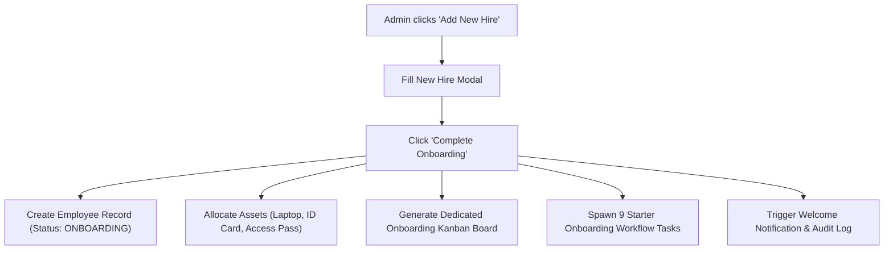

#### Purpose
To serve as the company's master employee phonebook and orchestrate complete new-hire onboarding.

#### Functionality
- **Department Filter**: Dropdown with 12 corporate departments, each populated with 2–3 team members.
- **Search Bar**: Real-time filtering across name, role, email, phone, and skill tags.
- **Status Filter**: Filter by `ACTIVE`, `ONBOARDING`, `ON_LEAVE`, `OFFBOARDING`, and `TERMINATED`.
- **CSV Export**: Exports the entire employee directory to an Excel-compatible `.csv` file.
- **Atomic Onboarding Engine**: When adding an employee, it automatically calculates HRA (40% of basic) and allowances (20% of basic).

#### How to Operate
1. **Filtering by Department**: Click the **All departments** dropdown and pick any category (e.g. *Software Engineering*). The table instantly isolates those members.
2. **Viewing an Employee Profile**: Click on any employee's name or row to open `/admin/directory/[id]`. Here you can view their salary breakdown, assigned assets, reporting line, and documents.
3. **Adding a New Employee**:
   - Click the blue **+ Add Employee** button in the top right.
   - Fill in First Name, Last Name, Email, Department, Designation, and Base Salary.
   - Click **Save / Onboard**. The directory counter updates immediately.

---

### Page 3: Leave Management & Absence Approvals
- **Routes**: `/admin/leaves`, `/employee/leaves`
- **Component Files**: `frontend/src/app/admin/leaves/page.tsx`, `frontend/src/app/employee/leaves/page.tsx`

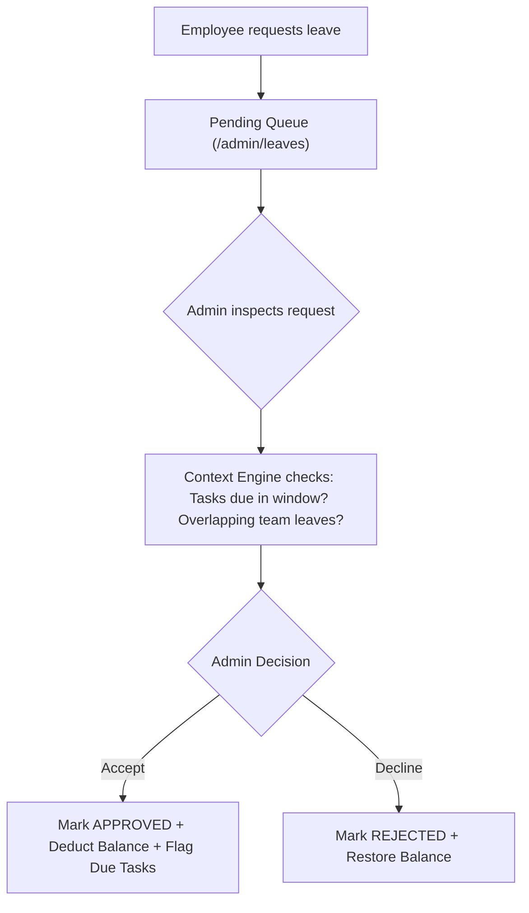

#### Purpose
Manages PTO, sick leaves, and casual absences with contextual risk detection so managers never approve leave without knowing what tasks will be affected.

#### Functionality
- **Pending Approvals Queue**: Live cards with employee name, leave type, dates, duration, and business reason.
- **Contextual Workload Alert**: Displays whether the applicant has overdue tasks or tasks due during their requested dates.
- **Peer Cover Recommendation**: Suggests an available team member in the same department to take over responsibilities.
- **Leave Balance Ledger**: Tracks Annual (18 days), Casual (12 days), and Sick (10 days) balances.

#### How to Operate
1. **To Approve a Leave**: Navigate to `/admin/leaves`. Look at the **Pending Requests** section. Review the applicant's reason and task warnings. Click the green **Approve** button.
2. **To Reject a Leave**: Click the red **Reject** button. The employee's balance is instantly restored.
3. **To Apply for Leave (as Employee)**: Navigate to `/employee/leaves`, click **Request Leave**, select the date range and leave type, type a reason, and click **Submit**.

---

### Page 4: Projects, Tasks & Interactive Kanban
- **Routes**: `/admin/projects`, `/employee/tasks`
- **Component Files**: `frontend/src/app/admin/projects/page.tsx`, `frontend/src/components/tasks/TaskComponents.tsx`

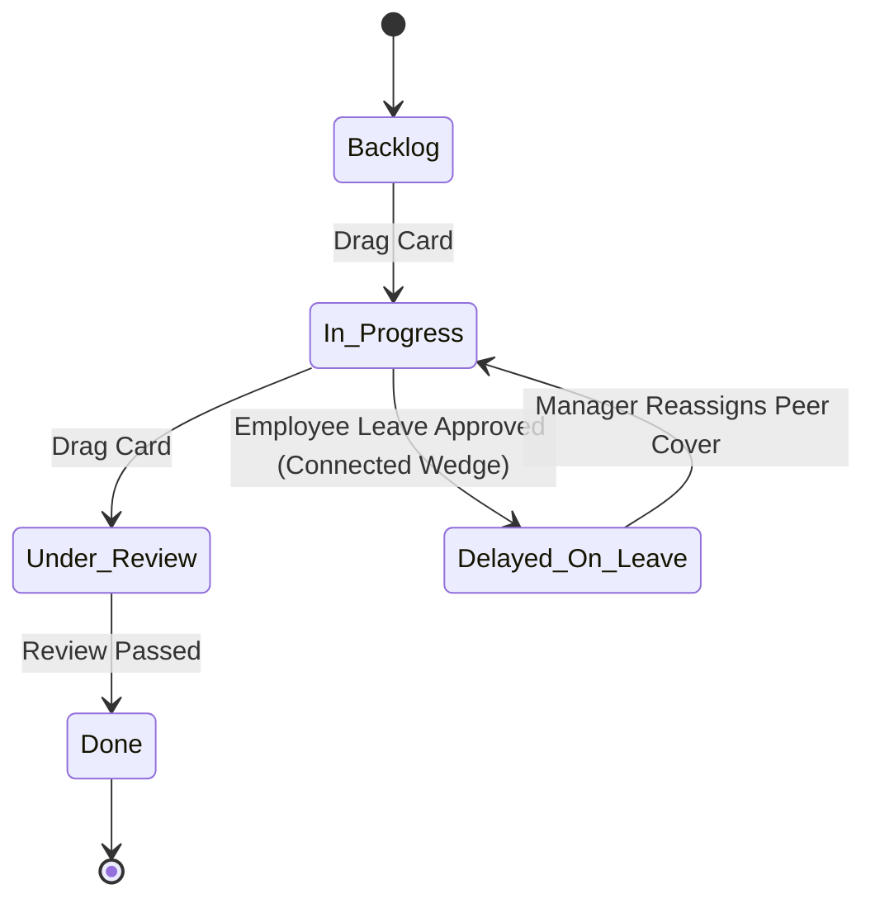

#### Purpose
Provides team-level and project-level work tracking using interactive Kanban boards with automated delay detection.

#### Functionality
- **Drag-and-Drop Columns**: Smooth drag-and-drop between *Backlog*, *In Progress*, *Under Review*, and *Done*.
- **Connected Delay Flags**: Automatically stamps yellow or red warning banners on tasks (`DELAYED_ON_LEAVE`, `DELAYED_HR_REVIEW`, `DELAYED_PAYROLL_LOCK`).
- **Priority Indicators**: `LOW` (slate), `MEDIUM` (blue), `HIGH` (amber), `URGENT` (rose).
- **Task Form Modal**: Create new tasks with title, description, priority, due date, assignee, and tags.

#### How to Operate
1. **Moving a Task**: Click and hold any task card, drag it horizontally to another column (e.g. from *In Progress* to *Done*), and release. The task status updates in the database instantly.
2. **Creating a Task**: Click the **+ New Task** button inside any column or at the top of the project. Fill in the title, assign an employee, choose a due date, and click **Create Task**.
3. **Inspecting Delay Details**: If a task has a red badge (`Delayed — On Leave`), click on it to open the detail modal. It will tell you who is on leave and recommend a peer to reassign it to.

---

### Page 5: Attendance, Clock-In & Timesheets
- **Routes**: `/admin/attendance`, `/employee/attendance`
- **Component Files**: `frontend/src/app/admin/attendance/page.tsx`, `frontend/src/components/employee/ClockWidget.tsx`

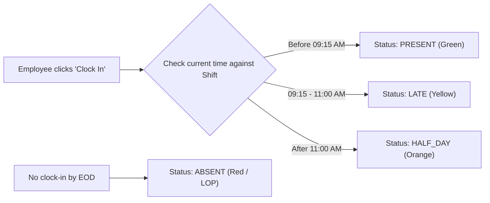

#### Purpose
Captures daily work hours, enforces shift policies, tracks punctuality, and provides project timesheet approval queues.

#### Functionality
- **Live Clock Widget**: Large digital clock with one-click **Clock In** and **Clock Out** buttons.
- **Biometric Status Rules**: Auto-classifies into `PRESENT`, `LATE`, `HALF_DAY`, or `ABSENT`.
- **Timesheet Approvals Table**: Shows project hours logged by employees with **Approve** and **Reject** buttons for managers.
- **Attendance Calendar Heatmap**: Displays monthly presence percentages.

#### How to Operate
1. **Clocking In (as Employee)**: On `/employee/attendance` or `/employee`, click the green **Clock In** button. Your check-in timestamp is recorded.
2. **Clocking Out**: At the end of the shift, click the red **Clock Out** button. Total active work hours are computed.
3. **Approving Timesheets (as Admin/Manager)**: On `/admin/attendance`, scroll down to **Pending Timesheets**. Review the hours logged for each project and click **Approve**.

---

### Page 6: Payroll Processing, Salaries & LOP Deductions
- **Routes**: `/admin/payroll`, `/employee/payslips`
- **Component Files**: `frontend/src/app/admin/payroll/page.tsx`, `frontend/src/components/Payslip.tsx`

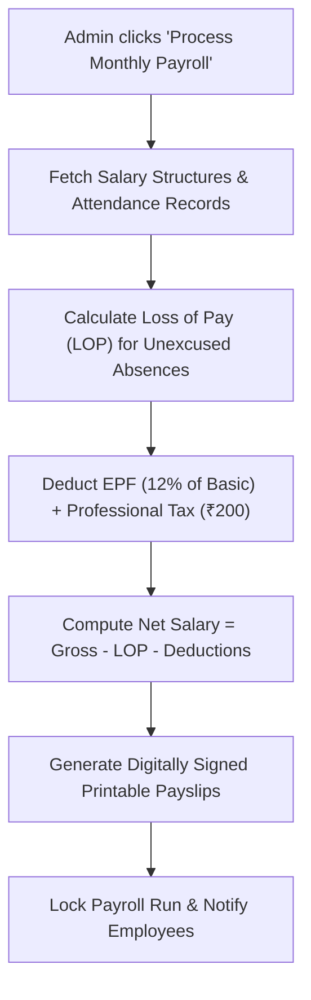

#### Purpose
Automates monthly corporate payroll calculation, tax withholdings, attendance-linked Loss of Pay (LOP) deductions, and generates printable payslips.

#### Functionality
- **One-Click Payroll Run**: Computes payroll across all active employees simultaneously.
- **Statutory Deductions Engine**: Automatically calculates Employee Provident Fund (EPF - 12% of basic), Professional Tax (₹200/mo), and Income Tax TDS.
- **Attendance-Linked LOP**: Automatically deducts $(Basic \div 30) \times Absent\_Days$ for unexcused absences.
- **Printable Payslip Modal**: Formats a formal payslip with company header, earnings, deductions, and Net Pay ready to download as PDF or print.

#### How to Operate
1. **Running Payroll**: Navigate to `/admin/payroll`. Select the month (e.g. *November 2026*). Click the purple **Process Payroll** button.
2. **Reviewing Salary Slips**: In the table below, view each employee's Gross Pay, LOP Deductions, and Net Pay.
3. **Printing a Payslip**: Click the **View Payslip** button next to any employee. A modal opens with the complete pay breakdown. Click **Print / Save as PDF**.

---

### Page 7: Executive Admin Overview & KPI Dashboard
- **Routes**: `/admin`, `/employee`
- **Component Files**: `frontend/src/app/admin/page.tsx`, `frontend/src/app/employee/page.tsx`

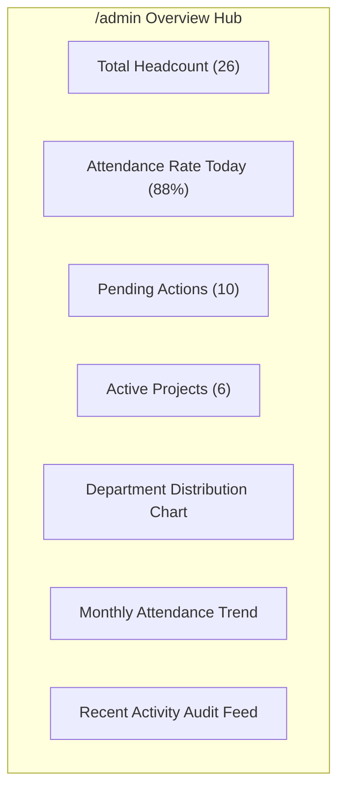

#### Purpose
Acts as the central cockpit for company executives and administrators to view high-level KPIs and operational bottlenecks.

#### Functionality
- **Stat Cards**: Total employees, onboarding new hires, team members on leave, and open tasks.
- **Executive Quick Links**: Direct navigation buttons to Directory, Leaves, Payroll, and Projects.
- **Recent Organization Feed**: Real-time log of recent approvals, new hires, and status changes.

#### How to Operate
1. Navigate to `/admin`.
2. Inspect the four top stat cards for an immediate pulse of company operations.
3. Use the quick-action pills in the header to jump to urgent queues (e.g. pending leaves or payroll review).

---

### Page 8: Expenses, Reimbursements & Receipt Auditing
- **Routes**: `/admin/expenses`, `/employee/expenses`
- **Component Files**: `frontend/src/app/admin/expenses/page.tsx`, `frontend/src/app/employee/expenses/page.tsx`

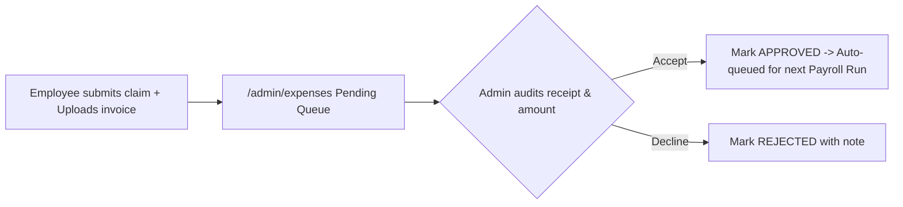

#### Purpose
Enables employees to claim corporate reimbursements (meals, equipment, travel, certifications) and allows finance admins to audit receipts and approve payments.

#### Functionality
- **Receipt Inspection**: View attached invoices and tax bills (`.pdf`, `.png`, `.jpg`).
- **Category Tagging**: Meals, Travel, Equipment, Training, Office Supplies, Internet.
- **One-Click Decisions**: **Approve** and **Decline** buttons with instant status synchronization.
- **Payroll Integration**: Approved reimbursements automatically feed into the employee's next monthly payroll run.

#### How to Operate
1. **Filing an Expense (as Employee)**: Navigate to `/employee/expenses`. Click **New Expense Claim**. Enter Title, Amount in ₹, Category, and attach receipt file. Click **Submit**.
2. **Auditing an Expense (as Admin)**: Navigate to `/admin/expenses`. Look at the **Pending Claims** table. Check the requester, amount, and click the receipt link to review the tax invoice.
3. **Deciding**: Click **Approve** to authorize reimbursement or **Decline** to reject.

---

### Page 9: Performance Management & 360° Appraisals
- **Routes**: `/admin/performance`, `/employee/performance`
- **Component Files**: `frontend/src/app/admin/performance/page.tsx`, `frontend/src/app/employee/performance/page.tsx`, `frontend/src/components/PerformanceMetrics.tsx`

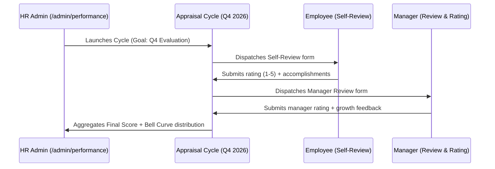

#### Purpose
Conducts structured performance review cycles, self-evaluations, manager feedback, and tracks objective delivery.

#### Functionality
- **Cycle Manager**: Create and track appraisal cycles (e.g. *Q4 2026 Annual Performance Cycle*).
- **Two-Sided Reviews**: Matches self-evaluation score against manager assessment score.
- **Objective Delivery Progress**: Live progress bars tracking completed OKRs and tasks.
- **Rating Matrix**: 1 (Unsatisfactory) to 5 (Exceeds Expectations).

#### How to Operate
1. **Launching a Cycle**: On `/admin/performance`, click **New Appraisal Cycle**. Name it, set the review deadline, and click **Launch**.
2. **Submitting Self-Review (as Employee)**: On `/employee/performance`, click **Complete Self-Review**. Fill in your rating, achievements, and click **Submit**.
3. **Completing Review (as Manager)**: Open the review queue, view the employee's self-score, provide manager feedback, select the final rating, and submit.

---

### Page 10: Access Control & Role-Based Permissions (RBAC)
- **Routes**: `/admin/access`
- **Component Files**: `frontend/src/app/admin/access/page.tsx`

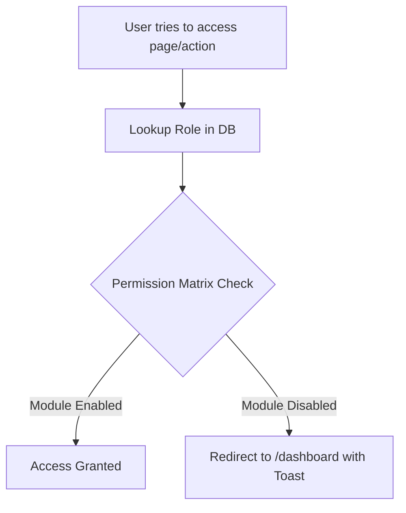

#### Purpose
Allows Super Admins to configure granular module permissions for each role and change employee roles.

#### Functionality
- **Interactive Permission Matrix**: Toggle checkboxes to grant or revoke access to any module (Directory, Leaves, Payroll, Projects, Settings, etc.) for `SUPER_ADMIN`, `HR_ADMIN`, `MANAGER`, or `EMPLOYEE`.
- **Role Reassignment Modal**: Promote or change any team member's role with one click.
- **Lockout Prevention**: System blocks accidental demotion of the primary Super Admin.

#### How to Operate
1. Navigate to `/admin/access`.
2. To toggle access for a role (e.g. allow Managers to view Payroll), click the corresponding checkbox in the matrix table. Click **Save Permissions**.
3. To change an employee's role, click **Change Role** next to their name in the user table, select the new role, and click **Confirm**.

---

### Page 11: Executive Reports, BI & CSV Export
- **Routes**: `/admin/reports`
- **Component Files**: `frontend/src/app/admin/reports/page.tsx`

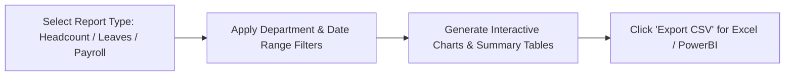

#### Purpose
Provides executive business intelligence, workforce distribution charts, attendance analytics, and one-click data exports.

#### Functionality
- **Four Core Report Tabs**:
  1. *Headcount & Demographics*: Department headcounts, gender ratios, work mode distribution.
  2. *Leave & Absenteeism*: PTO utilization rates and sick leave spikes.
  3. *Payroll & Compensation*: Total monthly salary expenditure, EPF liabilities, and average salary by department.
  4. *Project & Task Velocity*: Completed tasks vs delayed tasks.
- **One-Click CSV Export**: Download raw data tables formatted for Microsoft Excel or PowerBI.

#### How to Operate
1. Navigate to `/admin/reports`.
2. Click on the tab you want to analyze (e.g. *Payroll & Compensation*).
3. Use the department filter to narrow the report to a specific department.
4. Click the blue **Export CSV** button to download the spreadsheet.

---

### Page 12: Organization Settings, Shifts & Holidays
- **Routes**: `/admin/settings`
- **Component Files**: `frontend/src/app/admin/settings/page.tsx`

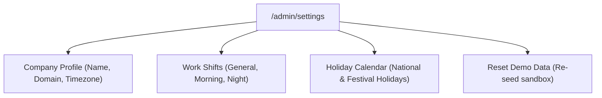

#### Purpose
Configures corporate branding, working hours, shift timings, official paid holidays, and demo resets.

#### Functionality
- **Company Profile Card**: Set official legal company name, domain, and primary timezone.
- **Work Shift Configuration**: Define standard start/end hours and grace periods.
- **Holiday Calendar**: Add national holidays (e.g. *Republic Day*, *Diwali*); the Leave Engine automatically excludes these dates from PTO deductions.
- **Demo Data Reset**: Instantly restores the database to standard authentic seed values.

#### How to Operate
1. Navigate to `/admin/settings`.
2. **Adding a Holiday**: Scroll to **Holiday Calendar**, enter the Holiday Name (e.g. *New Year's Day*) and Date (`2027-01-01`), and click **Add Holiday**.
3. **Resetting Demo Data**: Click **Reset Demo Data** if you ever want to reset all records back to default demo state.

---

### Page 13: Notifications Center & Live Organization Feed
- **Routes**: `/admin/notifications`, `/employee/notifications`
- **Component Files**: `frontend/src/app/admin/notifications/page.tsx`, `frontend/src/components/NotificationsCenter.tsx`

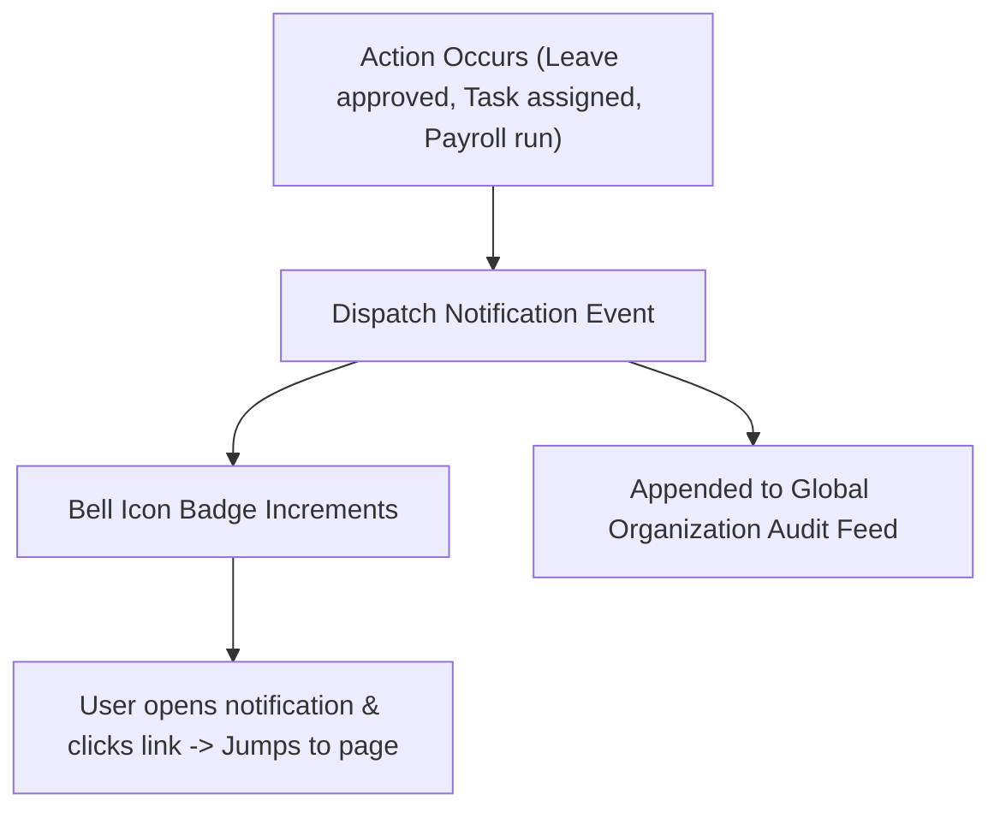

#### Purpose
Provides real-time notifications for operational events and maintains a secure audit log of all system changes.

#### Functionality
- **Header Notification Bell**: Displays unread badge counter.
- **Category Badges**: `LEAVE`, `TASK`, `PAYROLL`, `PERFORMANCE`, `SYSTEM`.
- **Deep Linking**: Clicking any notification takes the user directly to the relevant record.
- **Mark All as Read**: Clears unread notifications in one click.

#### How to Operate
1. Click the **Bell Icon** in the top navigation bar from any page to see the quick notification drawer.
2. To see the full page, navigate to `/admin/notifications` or `/employee/notifications`.
3. Click on any notification to navigate to the referenced task or leave request.

---

### Page 14: Visual Organization Hierarchy & Org Chart
- **Routes**: `/admin/org-chart`, `/employee/org-chart`
- **Component Files**: `frontend/src/app/admin/org-chart/page.tsx`, `frontend/src/components/org/OrgChart.tsx`

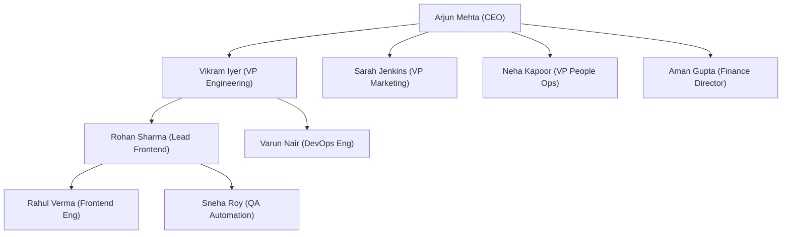

#### Purpose
Visualizes the corporate reporting chain from the CEO down to individual contributors with zoom, pan, and collapsible departments.

#### Functionality
- **Interactive Tree Hierarchy**: Expand and collapse branches with $(+)$ and $(-)$ buttons.
- **Node Cards**: Display photo avatar, full name, designation, department color badge, and direct report count.
- **Manager Reassignment**: Change reporting managers directly by dragging or clicking on an employee card.

#### How to Operate
1. Navigate to `/admin/org-chart`.
2. Click on the $(+)$ symbol under any manager to expand their direct reports.
3. Click on any employee card to view their complete contact details and reporting line.

---

### Page 15: My Profile & Employee Self-Service (ESS)
- **Routes**: `/employee/profile`
- **Component Files**: `frontend/src/app/employee/profile/page.tsx`

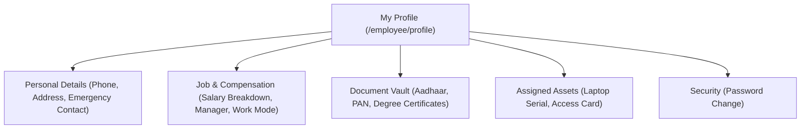

#### Purpose
Empowers employees to manage their personal information, inspect salary details, upload compliance documents, and change their password.

#### Functionality
- **Personal Details Form**: Edit phone number, residential address, emergency contact, and gender.
- **Job Details Card**: View official designation, department, reporting manager, joining date, and salary structure.
- **Assigned Company Assets**: Lists issued equipment (e.g. *MacBook Pro M2*, *YubiKey*, *Building Pass*).
- **Document Vault**: Upload identity proofs and degree certificates.
- **Change Password**: Self-service credential update.

#### How to Operate
1. Navigate to `/employee/profile`.
2. **To Update Phone / Contact**: Type the new phone number in the contact card and click **Save Changes**.
3. **To Upload a Document**: Click **Upload Document**, choose the file and type (e.g. *PAN Card*), and click **Upload**.
4. **To Change Password**: Enter your current password and new password (minimum 6 characters) and click **Update Password**.

---

### Page 16: My Team & Manager Collaboration Hub
- **Routes**: `/employee/team`
- **Component Files**: `frontend/src/app/employee/team/page.tsx`

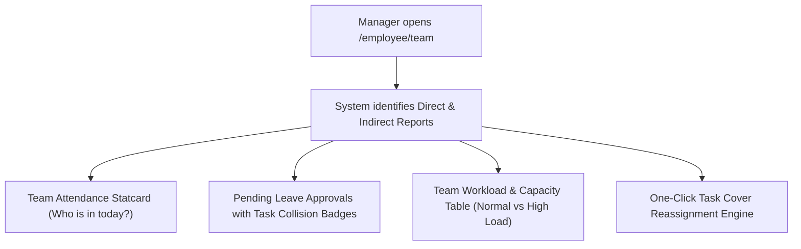

#### Purpose
A dedicated mission-control hub for team managers to oversee direct reports, monitor workload balance, approve team leaves, and reassign tasks.

#### Functionality
- **Manager Detection**: Non-managers see an intuitive empty state; managers see their full departmental roster.
- **Team Workload Table**: Shows active task count, overdue tasks, and assigns workload levels (`BALANCED`, `HEAVY`, `OVERLOADED`).
- **Contextual Leave Approvals**: Shows pending leaves for team members and flags if the leave clashes with an active project sprint.
- **Intelligent Peer Cover Engine**: Recommends another team member in the same department to cover delayed tasks with a one-click **Reassign** button.

#### How to Operate
1. Log in as a Manager (e.g. `rohan@workplace.com`).
2. Navigate to `/employee/team`.
3. Check the **Team Workload** table to see who has too many tasks.
4. Under **Pending Team Leaves**, click **Approve** or **Decline**. If a task is marked `Delayed — On Leave`, click the **Reassign Cover** button and select a teammate to take ownership.

---

## 6. Operator Recipes: Quick "How-To" Cheatsheet

### Recipe 1: How to Add a New Employee
1. Go to `/admin/directory`.
2. Click **+ Add Employee**.
3. Enter First Name, Last Name, Email, Department, Designation, and Base Salary.
4. Click **Complete Onboarding**. The employee is created, equipment is assigned, and their onboarding Kanban board is spawned.

### Recipe 2: How to Approve a Leave Request
1. Go to `/admin/leaves`.
2. Review the pending leave requests in the queue.
3. Check the yellow/red task collision alert.
4. Click the green **Approve** button. The employee is marked as On Leave, balance is deducted, and conflicting tasks are flagged.

### Recipe 3: How to Process Monthly Payroll
1. Go to `/admin/payroll`.
2. Select the pay period.
3. Click **Process Payroll**.
4. The system calculates LOP deductions, taxes, and generates printable salary slips.
5. Click **View Payslip** next to any employee to print or download.

### Recipe 4: How to Reassign a Delayed Task
1. Go to `/employee/team` or `/admin/projects`.
2. Locate the task marked with the red badge `Delayed — On Leave`.
3. Click the task card or click **Reassign Peer Cover**.
4. Select an available teammate from the suggested list and confirm.

---

## 7. Troubleshooting & FAQ

#### Q1: Why does a page show "Unknown" for an employee?
- **Cause**: An employee ID in a leave or task record does not exist in the database.
- **Solution**: Run `node database/scripts/seed-supabase.mjs` to synchronize all IDs with authentic employee records.

#### Q2: What happens if an employee loses internet or the Supabase cloud database is down?
- **Answer**: The application includes a transparent **In-Memory Fallback Engine** (`seed.ts`). If Supabase is unreachable, Workplace EMS automatically serves data from memory so no operations or presentations crash.

#### Q3: How do I change an employee's password?
- **Answer**: 
  - As an employee: Go to `/employee/profile` $\rightarrow$ **Change Password**.
  - As an admin: The default demo password for all accounts is `demo1234`.

#### Q4: How do I start the development server?
```bash
cd frontend
npm run dev -- -p 3001
```
Open **`http://localhost:3001`** in any web browser.

---

*Manual maintained by Team Magnum. Workplace Employee Management System (EMS).*
